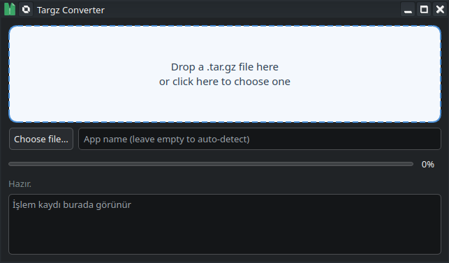

<h1 align="center">Targz Converter</h1>

<p align="center">Turn compressed archives into runnable Linux applications with a single drag-and-drop.</p>

## Features

<p align="center">
  
</p>

- Convert `.tar.gz`, `.tgz`, `.tar.xz`, `.tar.bz2`, `.AppImage`, `.rpm`, `.deb`, `.zip` and `.7z` archives into Linux apps
- Drag-and-drop window, file picker and command-line interface
- Dolphin (KDE) right-click menu and Nautilus (GNOME) script integration
- Automatic executable and icon detection (ELF signature + name matching, hicolor/pixmaps support)
- Generates standard `.desktop` entries for the application menu, desktop and autostart
- Per-app choices after conversion: desktop shortcut, autostart, launch now
- Batch conversion: convert multiple archives at once, with a guided per-app review screen
- Trusted desktop files (no "permission denied" prompts) and SELinux-aware installation
- Self-installer: `python3 install.py [--masaustune] [--kaldir]` (no root required)
- Fast: archives are scanned and extracted in a single pass; uses system `tar`/`pigz` when available

## Installation

Build and run the project locally:

```bash
git clone https://github.com/colgecen/Targz-Converter.git
cd Targz-Converter
python3 install.py            # add --masaustune to also create a desktop shortcut
```

To remove the installation:

```bash
python3 install.py --kaldir
```

Everything is installed under your user directories (`~/.local/share`, `~/.local/bin`); no root is required.

## Usage

Run it with:

```bash
targz-converter                       # open the drag-and-drop window
targz-converter archive.tar.gz        # open with a file preloaded
targz-converter --donustur a.tar.gz   # headless conversion (used by right-click menus)
targz-converter --donustur --ac a.tar.gz  # convert and launch
```

Drop an archive onto the window (or click the drop area to pick files), then choose the options in the result dialog and press **TAMAM**.

Configuration and installed apps live under `~/.local/share/Applications/`.

## Screenshots

<p align="center">
  
</p>

## License

This project is licensed under the [MIT](LICENSE) license.
